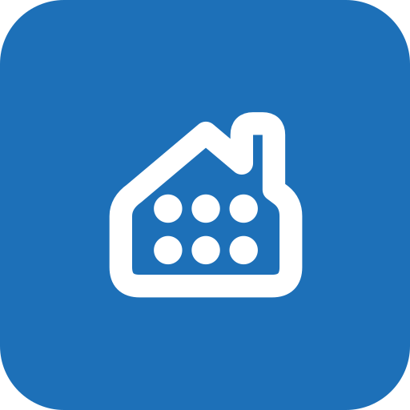

# Colour

Choose one of ten palettes and a Vivid or Muted variant. These choices change the brand primary and canvas while keeping status and data meanings consistent.

This page is generated from `design-system/palettes.json`. The [machine-readable palette reference](../reference/palettes.json) preserves every supplied hex, RGB, RGBA, CMYK and RAL or descriptive reference. Hex values in sRGB are authoritative for screens. CMYK and RAL entries reproduce the supplied specification; they are not measured colour-match guarantees.

## Palette overview

| Palette | Vivid primary | Vivid canvas | Muted primary | Muted canvas |
| --- | --- | --- | --- | --- |
| Civic Cobalt | `#1D70B8` | `#FFFFFF` | `#103E65` | `#F3F6F9` |
| Racing Moss | `#006853` | `#FFFFFF` | `#00392E` | `#F2F6F4` |
| Imperial Damson | `#732282` | `#FFFFFF` | `#3F1348` | `#F6F3F7` |
| Sovereign Crimson | `#B2292E` | `#FFFFFF` | `#621719` | `#F9F4F4` |
| Regimental Plum | `#532A45` | `#FFFFFF` | `#2E1726` | `#F7F3F5` |
| Oxford Midnight | `#003764` | `#FFFFFF` | `#001E37` | `#F2F4F8` |
| Ink Charcoal | `#0B0C0C` | `#FFFFFF` | `#2B2E30` | `#F3F2F1` |
| Heritage Ochre | `#8A6100` | `#FFFFFF` | `#4D3600` | `#F9F7F1` |
| Kiln Terracotta | `#9E3B0E` | `#FFFFFF` | `#572008` | `#F9F5F2` |
| Umber Bronze | `#5C3D28` | `#FFFFFF` | `#332216` | `#F6F4F1` |

## Try the variants

This demonstration changes only the example. To change Home Assistant, use [the profile colour controls](../get-started/colour-settings.html).

<label for="palette-preview">Colour palette</label>
<select id="palette-preview">
<option data-palette-id="civic-cobalt" data-vivid="#1D70B8" data-muted="#103E65" data-canvas="#F3F6F9">Civic Cobalt</option>
<option data-palette-id="racing-moss" data-vivid="#006853" data-muted="#00392E" data-canvas="#F2F6F4">Racing Moss</option>
<option data-palette-id="imperial-damson" data-vivid="#732282" data-muted="#3F1348" data-canvas="#F6F3F7">Imperial Damson</option>
<option data-palette-id="sovereign-crimson" data-vivid="#B2292E" data-muted="#621719" data-canvas="#F9F4F4">Sovereign Crimson</option>
<option data-palette-id="regimental-plum" data-vivid="#532A45" data-muted="#2E1726" data-canvas="#F7F3F5">Regimental Plum</option>
<option data-palette-id="oxford-midnight" data-vivid="#003764" data-muted="#001E37" data-canvas="#F2F4F8">Oxford Midnight</option>
<option data-palette-id="ink-charcoal" data-vivid="#0B0C0C" data-muted="#2B2E30" data-canvas="#F3F2F1">Ink Charcoal</option>
<option data-palette-id="heritage-ochre" data-vivid="#8A6100" data-muted="#4D3600" data-canvas="#F9F7F1">Heritage Ochre</option>
<option data-palette-id="kiln-terracotta" data-vivid="#9E3B0E" data-muted="#572008" data-canvas="#F9F5F2">Kiln Terracotta</option>
<option data-palette-id="umber-bronze" data-vivid="#5C3D28" data-muted="#332216" data-canvas="#F6F4F1">Umber Bronze</option>
</select>
<label><input type="checkbox"> Muted colours</label>

Living room temperature: <strong>21 °C</strong>

All monitored devices are available.

Civic Cobalt, Vivid preview. These choices affect this example only.

The V3.2 artwork preview uses the supplied lockups for the selected primary and canvas, plus its app icon. The accent dot colour comes from each original asset; CSS does not recolour it. [Read the artwork manifest](../reference/brand-assets.json).

## Light and dark modes

Vivid and Muted are colour-strength variants, independent of Home Assistant’s light, dark or automatic mode. Light mode uses the exact supplied primary and canvas. Dark mode uses neutral dark surfaces and lighter interactive tints derived from the selected primary, while retaining the supplied primary in the brand header. This is an explicit accessibility adaptation; the supplied off-white canvas is not represented as a dark colour.

The generator blends interaction tints 72% towards white in dark mode. Dark tokens are tested against their actual surfaces. The selected native mode is preserved when the palette changes.

## Keep functional colours stable

| Role | Light-mode base | Rule |
| --- | --- | --- |
| Main text | `#0B0C0C` | Use against the tested light canvas or card surface |
| Secondary text | `#484949` | Keep readable; do not fade with arbitrary opacity |
| Error | `#CA3535` | Error text/icon role; use dedicated fill/on-fill pair for banners |
| Success | `#0F7A52` | Confirmed success; independent of palette |
| Warning text | `#8A6100` | Dark ochre is a local contrast adaptation |
| Focus | Yellow `#FFDD00` and ink `#0B0C0C` | Custom controls use both colours; yellow alone is insufficient on white |

Native Home Assistant controls that expose only one outline colour use ink on light surfaces and yellow on dark surfaces. Dark brand masthead controls receive a scoped yellow treatment. Preserve native circle/pill shapes for switches, radio controls, avatars and gauges where their meaning depends on them.

Use `civica-danger-fill` with `civica-on-danger`, and the equivalent success, warning and notice pairs, for persistent banners. The lighter `error-color` in dark mode is intended for text/icons and is not automatically a safe white-text button fill.

Eight fixed chart-series colours have separate light/dark values and remain independent of the chosen palette. Prefer five or fewer series, direct labels and a data alternative. Contrast against the surface does not prove that adjacent series can be distinguished. See [Charts and tables](../components/charts.html).

## Exact colour references

RGB and RGBA values refer to screen colours. Print and paint references are supplied metadata. Do not replace the screen hex with an approximate RAL lookup.

### Civic Cobalt

| Variant and role | Hex | RGB | RGBA | CMYK | Supplied reference |
| --- | --- | --- | --- | --- | --- |
| Vivid primary | `#1D70B8` | 29, 112, 184 | 29, 112, 184, 1 | 84, 39, 0, 28 | RAL 5015 |
| Vivid canvas | `#FFFFFF` | 255, 255, 255 | 255, 255, 255, 1 | 0, 0, 0, 0 | RAL 9016 |
| Muted primary | `#103E65` | 16, 62, 101 | 16, 62, 101, 1 | 84, 39, 0, 60 | RAL 5011 |
| Muted canvas | `#F3F6F9` | 243, 246, 249 | 243, 246, 249, 1 | 2, 1, 0, 2 | Cool Mist Off-White |

### Racing Moss

| Variant and role | Hex | RGB | RGBA | CMYK | Supplied reference |
| --- | --- | --- | --- | --- | --- |
| Vivid primary | `#006853` | 0, 104, 83 | 0, 104, 83, 1 | 100, 0, 20, 59 | RAL 6005 |
| Vivid canvas | `#FFFFFF` | 255, 255, 255 | 255, 255, 255, 1 | 0, 0, 0, 0 | RAL 9016 |
| Muted primary | `#00392E` | 0, 57, 46 | 0, 57, 46, 1 | 100, 0, 19, 78 | RAL 6009 |
| Muted canvas | `#F2F6F4` | 242, 246, 244 | 242, 246, 244, 1 | 2, 0, 1, 4 | Soft Sage Off-White |

### Imperial Damson

| Variant and role | Hex | RGB | RGBA | CMYK | Supplied reference |
| --- | --- | --- | --- | --- | --- |
| Vivid primary | `#732282` | 115, 34, 130 | 115, 34, 130, 1 | 12, 74, 0, 49 | RAL 4008 |
| Vivid canvas | `#FFFFFF` | 255, 255, 255 | 255, 255, 255, 1 | 0, 0, 0, 0 | RAL 9016 |
| Muted primary | `#3F1348` | 63, 19, 72 | 63, 19, 72, 1 | 12, 74, 0, 72 | RAL 5022 |
| Muted canvas | `#F6F3F7` | 246, 243, 247 | 246, 243, 247, 1 | 0, 2, 0, 3 | Pale Heather Off-White |

### Sovereign Crimson

| Variant and role | Hex | RGB | RGBA | CMYK | Supplied reference |
| --- | --- | --- | --- | --- | --- |
| Vivid primary | `#B2292E` | 178, 41, 46 | 178, 41, 46, 1 | 0, 77, 74, 30 | RAL 3003 |
| Vivid canvas | `#FFFFFF` | 255, 255, 255 | 255, 255, 255, 1 | 0, 0, 0, 0 | RAL 9016 |
| Muted primary | `#621719` | 98, 23, 25 | 98, 23, 25, 1 | 0, 77, 74, 62 | RAL 3005 |
| Muted canvas | `#F9F4F4` | 249, 244, 244 | 249, 244, 244, 1 | 0, 2, 2, 2 | Warm Alabaster Off-White |

### Regimental Plum

| Variant and role | Hex | RGB | RGBA | CMYK | Supplied reference |
| --- | --- | --- | --- | --- | --- |
| Vivid primary | `#532A45` | 83, 42, 69 | 83, 42, 69, 1 | 0, 49, 17, 67 | RAL 4007 |
| Vivid canvas | `#FFFFFF` | 255, 255, 255 | 255, 255, 255, 1 | 0, 0, 0, 0 | RAL 9016 |
| Muted primary | `#2E1726` | 46, 23, 38 | 46, 23, 38, 1 | 0, 50, 17, 82 | RAL 4007 |
| Muted canvas | `#F7F3F5` | 247, 243, 245 | 247, 243, 245, 1 | 0, 2, 1, 3 | Soft Rose-Chalk Off-White |

### Oxford Midnight

| Variant and role | Hex | RGB | RGBA | CMYK | Supplied reference |
| --- | --- | --- | --- | --- | --- |
| Vivid primary | `#003764` | 0, 55, 100 | 0, 55, 100, 1 | 100, 45, 0, 61 | RAL 5003 |
| Vivid canvas | `#FFFFFF` | 255, 255, 255 | 255, 255, 255, 1 | 0, 0, 0, 0 | RAL 9016 |
| Muted primary | `#001E37` | 0, 30, 55 | 0, 30, 55, 1 | 100, 45, 0, 78 | RAL 5004 |
| Muted canvas | `#F2F4F8` | 242, 244, 248 | 242, 244, 248, 1 | 2, 2, 0, 3 | Slate Porcelain Off-White |

### Ink Charcoal

| Variant and role | Hex | RGB | RGBA | CMYK | Supplied reference |
| --- | --- | --- | --- | --- | --- |
| Vivid primary | `#0B0C0C` | 11, 12, 12 | 11, 12, 12, 1 | 8, 0, 0, 95 | RAL 9005 |
| Vivid canvas | `#FFFFFF` | 255, 255, 255 | 255, 255, 255, 1 | 0, 0, 0, 0 | RAL 9016 |
| Muted primary | `#2B2E30` | 43, 46, 48 | 43, 46, 48, 1 | 10, 4, 0, 81 | RAL 7021 |
| Muted canvas | `#F3F2F1` | 243, 242, 241 | 243, 242, 241, 1 | 0, 0, 1, 5 | GOV.UK Warm Stone Grey |

### Heritage Ochre

| Variant and role | Hex | RGB | RGBA | CMYK | Supplied reference |
| --- | --- | --- | --- | --- | --- |
| Vivid primary | `#8A6100` | 138, 97, 0 | 138, 97, 0, 1 | 0, 30, 100, 46 | RAL 8000 |
| Vivid canvas | `#FFFFFF` | 255, 255, 255 | 255, 255, 255, 1 | 0, 0, 0, 0 | RAL 9016 |
| Muted primary | `#4D3600` | 77, 54, 0 | 77, 54, 0, 1 | 0, 30, 100, 70 | RAL 8008 |
| Muted canvas | `#F9F7F1` | 249, 247, 241 | 249, 247, 241, 1 | 0, 1, 3, 2 | Warm Parchment Off-White |

### Kiln Terracotta

| Variant and role | Hex | RGB | RGBA | CMYK | Supplied reference |
| --- | --- | --- | --- | --- | --- |
| Vivid primary | `#9E3B0E` | 158, 59, 14 | 158, 59, 14, 1 | 0, 63, 91, 38 | RAL 8004 |
| Vivid canvas | `#FFFFFF` | 255, 255, 255 | 255, 255, 255, 1 | 0, 0, 0, 0 | RAL 9016 |
| Muted primary | `#572008` | 87, 32, 8 | 87, 32, 8, 1 | 0, 63, 91, 66 | RAL 8015 |
| Muted canvas | `#F9F5F2` | 249, 245, 242 | 249, 245, 242, 1 | 0, 2, 3, 2 | Soft Clay Cream Off-White |

### Umber Bronze

| Variant and role | Hex | RGB | RGBA | CMYK | Supplied reference |
| --- | --- | --- | --- | --- | --- |
| Vivid primary | `#5C3D28` | 92, 61, 40 | 92, 61, 40, 1 | 0, 34, 57, 64 | RAL 8011 |
| Vivid canvas | `#FFFFFF` | 255, 255, 255 | 255, 255, 255, 1 | 0, 0, 0, 0 | RAL 9016 |
| Muted primary | `#332216` | 51, 34, 22 | 51, 34, 22, 1 | 0, 33, 57, 80 | RAL 8019 |
| Muted canvas | `#F6F4F1` | 246, 244, 241 | 246, 244, 241, 1 | 0, 1, 2, 4 | Warm Linen Off-White |

## Maintain the tokens

Edit the canonical JSON, then run `node scripts/generate-themes.mjs` and `python3 docs/scripts/sync-palettes.py` from the repository root. Commit the generated YAML, theme JSON and this colour reference together. Use `--check` on both generators to detect drift.

The native theme name is `civica {palette name} {Vivid|Muted}`. The `govuk` entry is a compatibility alias for Civic Cobalt Vivid and uses civica.uk branding.

The semantic role approach follows [GOV.UK colour guidance](https://design-system.service.gov.uk/styles/colour/). The ten named palettes and theme toggle are local civica.uk decisions.
